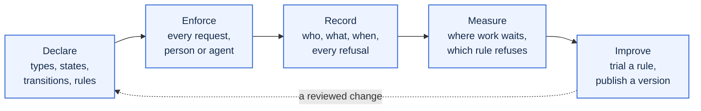
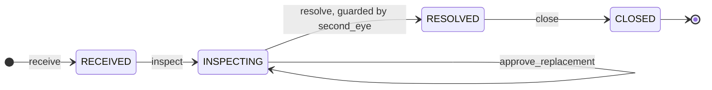
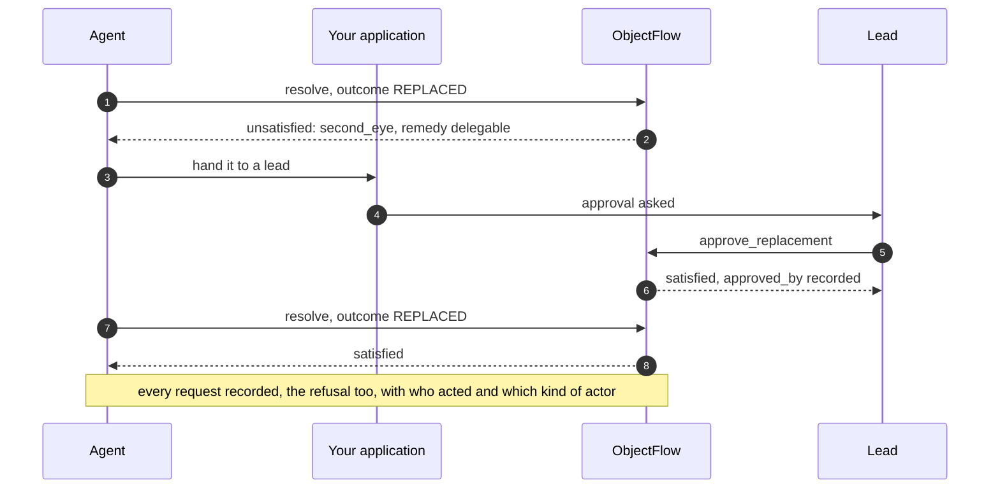
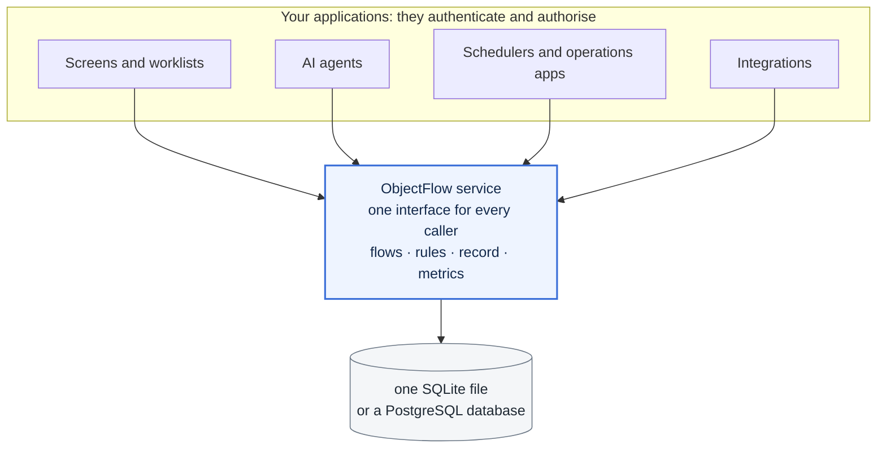

# ObjectFlow

**An agent-safe system of record for business workflows.**

[](https://github.com/rxdu/object_flow/actions/workflows/check.yml)
[](https://github.com/rxdu/object_flow/releases/latest)
[](LICENSE)

People and agents move business objects only along declared transitions. Every change is checked against the flow's rules, recorded with who made it, and measured from the first request.

> **Status: pre-1.0, ready to pilot.** The engine runs as an HTTP service on one SQLite file or a PostgreSQL database, and is released for piloting a flow on one machine. Until 1.0.0 a release may still change the API and the flow format, each change listed in the [changelog](CHANGELOG.md). See [status and limits](#status-and-limits).



## The problem

**Business rules end up everywhere.** The same rule is checked in a route, again in a service method, again in a model hook and once more in a database constraint, each copy a little different. Nobody can print what the system allows, review it, or hand it to an agent.

**Flows are defined once and never measured.** A system of record keeps the result of each step and nothing about the flow: where work waits, which rule is in the way, whether a change to the process helped.

**AI agents now act on business systems.** They need rules they cannot bypass, answers they can act on when they are refused, and the same data a person sees.

## What it does

| | |
|---|---|
| **Declare** | Object types, their states, the transitions between them and the rules on each are written once, in YAML. A declaration is checked when it is published, can be printed for review, and is the only authority on what may change. |
| **Enforce** | Every request, from a person, a service or an agent, is checked against the declared rules. A refusal names the rule that refused and what to do next: supply something, ask someone, wait, or work on another object first. A rule can instead be a flag, which lets the request through and says so. Nothing is ever half-applied. |
| **Record** | Every transition, refusal, override and change of hands is kept, with who acted, what kind of actor they were, and when it happened as well as when it was recorded. Nothing is edited, only corrected. |
| **Measure** | Time in each state, throughput, where work waits and which rules refuse most exist from the first request, with nothing to instrument. Metrics are declared once and read the same way by every screen, report and agent. |
| **Improve** | A flow can start with no rules at all. The record shows where the flow and reality disagree, a new rule can run on trial before it is enforced, and a change is a reviewed publish that keeps history intact. |

## What it looks like

A returns flow, published with no rules at all and measured from its first request:

```yaml
types:
  Return:
    description: A unit a customer sent back, from its receipt to its resolution.
    tracking: record
    attributes:
      unit:     { reference: Robot }
      customer: { reference: Customer }
    states:
      RECEIVED:   { category: inbound }
      INSPECTING: { category: live }
      RESOLVED:   { category: closed }
      CLOSED:     { category: closed, final: true }
    transitions:
      receive: { kind: initial, to: RECEIVED, required_inputs: [unit, customer] }
      inspect: { kind: external, from: RECEIVED, to: INSPECTING }
      resolve: { kind: external, from: INSPECTING, to: RESOLVED }
      close:   { kind: external, from: RESOLVED, to: CLOSED }
```

A month later its own data shows where it waits, and the next version adds a rule only where it is needed: a replacement needs a lead's approval once the unit's model keeps coming back.



```yaml
    conditions:
      second_eye:
        description: A replacement carries a lead's recorded approval once the unit's model has had five or more returns in thirty days.
        expression: >-
          inputs.outcome != ReturnOutcome.REPLACED
          or approved_by is not null
          or metric(returns_by_model, model := unit.model, over last 30 days) < 5
        remedy: delegable
    transitions:
      approve_replacement:
        kind: internal
        from: INSPECTING
        effect:
          - assign: { location: approved_by, expr: actor.id }
      resolve:
        kind: external
        from: INSPECTING
        to: RESOLVED
        inputs:
          outcome: { type: ReturnOutcome }
        guards:
          second_eye: deny
```

An agent that asks for a replacement before a lead has approved it gets an answer it can act on, not an error:



The rule reads that an approval was recorded, and by whom; who counts as a lead is your application's decision. Both versions are checked modules in [`docs/design/returns-module.md`](docs/design/returns-module.md).

## Built for AI agents

Agents are governed exactly as people are, which is what makes handing them work safe.

- **One interface, one set of rules.** An agent acts through the same requests as a person and is refused by the same rules. There is no side door.
- **It can ask what it may do.** `availability` evaluates the real rules against the real data and says, for each transition, whether it is available, needs input, or is blocked and why.
- **A refusal is an instruction.** Every refusal carries a remedy, so an agent knows whether to fix its request, ask a person, wait, or work on something else first; a refusal over its inputs names them.
- **Its tools come from the rules.** Agent tool definitions are generated from the declaration, so they cannot drift from what is enforced.
- **What an agent is, is declared.** Whether an actor is a person, an agent or a service is declared with its type, so every record and every metric says truthfully which kind of actor acted.
- **Agents draft, people approve.** An agent can draft a change to a flow or file a proposal for a request; your application decides who approves, and the record keeps both.

## Try it

The latest release for Linux x86_64, checked against its SHA-256, run as a sandbox: an in-memory store with a clock of its own.

```sh
gh release download -R rxdu/object_flow -p '*x86_64-linux.tar.gz*'
sha256sum -c objectflow-service-*.sha256 && tar xzf objectflow-service-*.tar.gz
./objectflow-service-*/objectflow-service --port 8712
```

Or build it from source with `(cd core && cargo build --release -p objectflow-service)`. In a second terminal, save a small flow as `leave.yaml`:

```yaml
module: leave
categories: [live, closed]
types:
  LeaveRequest:
    description: A request for days off.
    tracking: record
    attributes:
      days: { type: int }
    states:
      DRAFT: { category: live, description: Being written. }
      APPROVED: { category: closed, final: true, description: Granted. }
    conditions:
      reasonable:
        description: A request asks for 1 to 20 days.
        expression: inputs.days >= 1 and inputs.days <= 20
        remedy: self_serviceable
    transitions:
      open: { kind: initial, to: DRAFT, required_inputs: [days], guards: { reasonable: deny } }
      approve: { kind: external, from: DRAFT, to: APPROVED }
```

Load it, and ask for 30 days:

```sh
OF=http://127.0.0.1:8712
jq -Rs '{files: [{name: "leave.yaml", text: .}]}' leave.yaml \
  | curl -s $OF/sandbox/load -H 'Content-Type: application/json' -d @-
curl -s $OF/v1/request -H 'Content-Type: application/json' \
  -d '{"actor": {"id": "operator"}, "type": "LeaveRequest", "transition": "open", "inputs": {"days": 30}}'
```

```json
{"kind": "unsatisfied", "remedy": "self_serviceable", "clause": "reasonable", "unknown": false, "objects": [], "proposable": false, "inputs": ["days"], "consulted": {}}
```

The refusal names the rule, what to do about it, and the input to fix. The [quickstart](docs/guides/quickstart.md) goes on from here: actors, history, metrics.

## Where it sits



ObjectFlow runs as an internal service beside your applications, one per store, and it is the only thing that writes the store. Your applications authenticate their users and decide what each may do and see; ObjectFlow enforces the flow's rules on every request and records who made it.

| It is not | Because |
|---|---|
| A workflow orchestrator | It never starts a transition. Schedules, timers, chasing and notifications live in your applications, which act through the same interface as anyone else. |
| A UI or low-code platform | It has no screens, though it answers by query every question a worklist needs. |
| An identity or permission system | Who a caller is, and what they may do and see, stay with your applications. |
| An analytics warehouse | It computes its declared metrics, and exports its data for exploration elsewhere. |

| Why not just use… | It gives you | ObjectFlow adds |
|---|---|---|
| An ORM | A mapping of tables, executing whatever the caller asks | The rules: what may change and when, and a record of who changed it |
| A state-machine library | Transitions checked inside one application | One authority every caller goes through, recorded and measured |
| A workflow engine | Processes driven forward | Governance of the data those processes touch, leaving the driving to them |

## Status and limits

| Ready for | Not yet |
|---|---|
| Piloting a flow on one machine, on SQLite or PostgreSQL | Several writing instances, or a second service standing by |
| Upgrading a store to a newer release in place | Authentication: whoever reaches the service can act as any actor, by design, so it sits behind your application |
| Reads answered beside writes, in pages | Recovery of more than the last backup holds |
| Health and metrics for operators, and backups taken while it serves | The promise a release keeps from 1.0.0 on the API, the flow format and the store's upgrade |

The limits a production accepts are in [`SECURITY.md`](SECURITY.md), what a release promises in [ADR-0180](docs/adr/0180-what-a-release-promises.md), and why releases are 0.x until then in [ADR-0214](docs/adr/0214-a-release-before-1-0-0.md). [`TODO.md`](TODO.md) says exactly where the work stands.

## Documentation

| I want to… | Start here |
|---|---|
| See it run in ten minutes | [Quickstart](docs/guides/quickstart.md), then [concepts](docs/guides/concepts.md), the model on one page |
| Write a flow | [Write a flow](docs/guides/write-a-flow.md), and every key on one page in the [flow format card](docs/guides/flow-format-card.md) |
| Build an application on it | [Build an application](docs/guides/integrate.md), [agents](docs/guides/agents.md), the [API reference](docs/guides/wire.md) and [errors and refusals](docs/guides/errors.md) |
| Run it in production | [Operate a deployment](docs/guides/operate.md); building the engine is [`core/README.md`](core/README.md) |
| Edit and simulate flows | The [Flow Studio](apps/flow-studio/README.md), an editor and simulator built on the engine |
| Know what changed | The [changelog](CHANGELOG.md) |

## The design record

ObjectFlow is designed in the open, every choice written down with what it rejected.

- [**Requirements**](docs/PRD.md): what the product must do, and the use cases every design choice is tested against.
- [**Design**](docs/DESIGN.md): the model, how a request executes, history, the read surface, and the known limits.
- [**Declaration language**](docs/design/declaration-syntax.md): the language flows are written in, and the checks publishing runs over it.
- [**Decisions**](docs/adr/): each one with the alternatives it rejected and why.
- [**Traceability**](docs/design/traceability.md): every requirement mapped to what meets it, a checker failing while any is not covered.
- **Worked examples**: [a unit's journey](docs/design/unit-journey.md), [a returns flow](docs/design/returns-module.md), and [a catalogue of Jira's typical flows](docs/design/jira-flows.md), each a checked module.
- **Reviews**: cold reviews in which agents new to ObjectFlow built an application on it and recorded what hurt ([procurement](docs/design/procurement-cold-draft.md), [its second round](docs/design/procurement-second-review.md)), and [whether a builder can recover a flow](docs/design/flow-recoverability-review.md) from the specification alone.

The engine's core is written in Rust and held to a Python reference runner, both running every example in the record. To check the record, build the scripts' Python environment once with `scripts/setup/python-env`, then run `scripts/.venv/bin/python scripts/check-corpus.py`.

## License

[Apache License 2.0](LICENSE).
