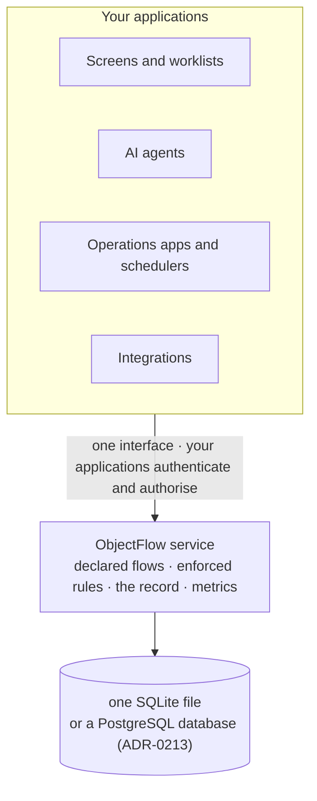

# ObjectFlow

**An agent-safe system of record for business workflows.**

Governed flows for business objects. People and agents move objects only along declared transitions; every change is checked, recorded and measured.

> **Status: in design, with a running core.** The design is complete and under its author's review: the requirements, the model, the language flows are declared in, every decision with the alternatives it rejected, and the checkers that hold it together. The engine's core runs, in Rust, held to a Python reference runner: as a sandbox's service, on which the Flow Studio is built, and as a deployment's, whose store is one SQLite file or a PostgreSQL database that survives a restart, on the wall clock, asking external systems over HTTP. It is ready to pilot a flow on one machine, a newer engine release taking over a store by an upgrade, its reads running beside its writes and answered in pages, and not yet for production: its writes run one at a time through one writer, it authenticates nobody, leaving that to the application in front of it, and what a release promises binds from 1.0.0 ([ADR-0180](docs/adr/0180-what-a-release-promises.md)), which follows the first consumer's working system; until then releases are 0.x, the latest 0.4.0 ([ADR-0214](docs/adr/0214-a-release-before-1-0-0.md)). See [getting started](#getting-started) and [where it stands](#where-it-stands).

## The problem

**Business rules end up everywhere.** In the first consumer, the system being rebuilt on ObjectFlow, 454 sites refuse an operation. **176 of them are redundant**, the same rule expressed again somewhere else, and 51 distinct rules appear at more than one site, across route checks, service methods, model hooks and database constraints. One rule, "a delivery must be in preparation", is written five times in four files. Nobody can print what the system allows, review it, or hand it to an agent.

**Flows are defined once and never measured.** A system of record keeps the result of each step and nothing about the flow: where work waits, which rule is in the way, whether a change to the process helped.

**AI agents now act on business systems.** They need rules they cannot bypass, answers they can act on when they are refused, and the same data a person sees.

## What it does

- **Declare.** Object types, their states, the transitions between them and the rules on each are written once, in a small language. A declaration is checked when it is published, can be printed for review, and is the only authority on what may change.
- **Enforce.** Every request, from a person, a service or an agent, is checked against the declared rules. A refusal names the rule that refused and what to do next: supply something, ask someone, wait, or work on another object first. A rule can instead be a flag, which lets the request through and tells the caller and the record. Nothing is ever half-applied.
- **Record.** Every transition, refusal, override and change of hands is kept, with who did it, what kind of actor they were, and when it happened as well as when it was recorded. People add their own datapoints, such as an inspection result, and nothing is edited, only corrected.
- **Measure.** Time in each state, throughput, where work waits, which rules refuse most and who holds what exist from the first request, with nothing to instrument. Formulas and metrics are declared once and read the same way by every screen, report and agent. Every figure that names a person says so, so your applications can put per-person numbers behind their own door.
- **Improve.** A flow can start with no rules at all. The record shows where the flow and reality disagree, a new rule can run on trial before it is enforced, and a change is a reviewed publish that keeps history intact.

## Built for AI agents

Agents are governed exactly as people are, which is what makes handing them work safe.

- **One interface, one set of rules.** An agent acts through the same requests as a person and is refused by the same rules. There is no side door.
- **It can ask what it may do.** `availability` evaluates the real rules against the real data and says, for each transition, whether it is available, needs input, or is blocked and why.
- **A refusal is an instruction.** Every refusal carries a remedy, so an agent knows whether to fix its request, ask a person, wait, or work on something else first.
- **Its tools come from the rules.** Agent tool definitions are generated from the declaration, by `tools` for an actor kind (ADR-0173), so they cannot drift from what is enforced.
- **What an agent is, is declared.** Whether an actor is a person, an agent or a service is declared with its type, so every record and every metric says truthfully which kind of actor acted, whatever a request claims.
- **Agents draft, people approve.** An agent can draft a change to a flow, or file a proposal for a request. Your application decides who approves, and the record keeps who drafted and who approved.
- **Permissions stay with your application.** ObjectFlow never decides who may act. Your application does, sending the version it read, so its check cannot race a change.
- **Agents are measured beside people.** Every metric splits by kind of actor, so you can see where agents stall and people do not.

## What it looks like

A returns flow, published with no rules at all and measured from its first request:

```yaml
types:
  Return:
    description: A unit a customer sent back, from its receipt to its resolution.
    tracking: record
    attributes:
      unit:     { reference: Robot }
      customer: { reference: Customer }
    states:
      RECEIVED:   { category: inbound }
      INSPECTING: { category: live }
      RESOLVED:   { category: closed }
      CLOSED:     { category: closed, final: true }
    transitions:
      receive: { kind: initial, to: RECEIVED, required_inputs: [unit, customer] }
      inspect: { kind: external, from: RECEIVED, to: INSPECTING }
      resolve: { kind: external, from: INSPECTING, to: RESOLVED }
      close:   { kind: external, from: RESOLVED, to: CLOSED }
```

A month later its own data shows where it waits, and the next version adds rules only where they are needed. A replacement now needs a lead's approval once the robot's model keeps coming back:

```yaml
    conditions:
      second_eye:
        description: A replacement carries a lead's recorded approval once the unit's model has had five or more returns in thirty days.
        expression: >-
          inputs.outcome != ReturnOutcome.REPLACED
          or approved_by is not null
          or metric(returns_by_model, model := unit.model, over last 30 days) < 5
        remedy: delegable
    transitions:
      approve_replacement:
        kind: internal
        from: INSPECTING
        effect:
          - assign: { location: approved_by, expr: actor.id }
      resolve:
        kind: external
        from: INSPECTING
        to: RESOLVED
        inputs:
          outcome: { type: ReturnOutcome }
        guards:
          second_eye: deny
```

An engineer, or an agent, who asks for a replacement before a lead has approved it gets an answer it can act on rather than an error:

```json
{"kind": "unsatisfied", "clause": "second_eye", "remedy": "delegable"}
```

The rule reads that an approval was recorded, and by whom. Who counts as a lead is your application's decision.

Both versions are checked modules in [`docs/design/returns-module.md`](docs/design/returns-module.md).

## Where it sits



ObjectFlow runs as an internal service beside your applications, one per store, and it is the only thing that writes the store. Your applications authenticate their users and decide what each may do and see. ObjectFlow enforces the flow's rules on every request and records who made it ([ADR-0114](docs/adr/0114-objectflow-records-who-acted-and-never-evaluates-it.md)).

What it is not:
- **Not a workflow orchestrator.** It never starts a transition. Schedules, timers, chasing and notifications live in the applications above it, which act through the same interface as anyone else.
- **Not a UI or low-code platform.** It has no screens, though it answers by query every question a worklist needs.
- **Not an identity or permission system.** Who a caller is, and what they may do and see, stay with your applications.
- **Not an analytics warehouse.** It computes its declared metrics, and exports its data for exploration elsewhere.

## Why not just use…

- **An ORM?** An ORM abstracts mechanism: it hides SQL and faithfully executes whatever the caller asks. ObjectFlow abstracts the rules: what may change and when, and it records who changed it.
- **A state-machine library?** It checks transitions inside one application. Any other code path can still write the table, and nothing is recorded or measured.
- **A workflow engine?** It drives processes forward. ObjectFlow governs the data those processes touch, and leaves the driving to them.

## Designed against a real system

ObjectFlow's case study, called the first consumer, is the author's robotics operations platform: inventory, deliveries and service in production today, with loans and leasing designed. The first application built on the engine is the Flow Studio ([`flow-studio.md`](docs/design/flow-studio.md)), an editor, viewer and simulator of flows in this repository. The design has been checked rule by rule against that system's production code ([`first-consumer-audit.md`](docs/design/first-consumer-audit.md)) and against its own product requirements ([`first-consumer-prd-check.md`](docs/design/first-consumer-prd-check.md)). Its worked examples are written as checked modules: a unit's whole journey from purchase request to lease-to-own, and a returns flow tightened from its own data.

## Getting started

The [guides](docs/guides/README.md) take you from a first request to production:

- **New here**: the [quickstart](docs/guides/quickstart.md) runs the engine and makes your first requests in about ten minutes; [concepts](docs/guides/concepts.md) is the model on one page.
- **Write a flow**: [write a flow](docs/guides/write-a-flow.md), from an empty file to examples passing on both of the engine's implementations, and every key on one page, the [flow format card](docs/guides/flow-format-card.md).
- **Build an application on it**: [build an application](docs/guides/integrate.md), [agents](docs/guides/agents.md), the [API reference](docs/guides/wire.md) and [errors and refusals](docs/guides/errors.md).
- **Run it**: [operate a deployment](docs/guides/operate.md); building the engine is [`core/README.md`](core/README.md).
- **What a later release may change**: within the wire's `/v1` and the flow format, a release only adds; a check that would refuse a flow it accepted arrives as a notice first; a store is upgraded, never stranded ([ADR-0180](docs/adr/0180-what-a-release-promises.md), binding from release 1.0.0; a major version is maintained for 12 months after the next major's first release, [ADR-0182](docs/adr/0182-before-1-0-the-authors-decisions.md)).
- **See a flow run**: the [Flow Studio](apps/flow-studio/README.md), an editor and simulator of flows.

## Where it stands

In design, under review by its author. What exists:

- [**Requirements**](docs/PRD.md): what the product must do, and the use cases every design choice is tested against.
- [**Design**](docs/DESIGN.md): the model, how a request executes, history, the read surface, and the known limits.
- [**Declaration language**](docs/design/declaration-syntax.md): the language flows are written in, and the checks publishing runs over it, enforced by a checker against every example in the record.
- [**Decisions**](docs/adr/): each one with the alternatives it rejected and why.
- [**Traceability**](docs/design/traceability.md): every requirement mapped to what meets it; a checker fails while any is not covered.
- **Worked examples**: [a unit's journey](docs/design/unit-journey.md), [a returns flow](docs/design/returns-module.md), and [an operations review](docs/design/flow-review.md) of the journey.
- **Jira's typical flows**: [a catalogue](docs/design/jira-flows.md) of the workflows Jira's templates ship, each a checked module with its state diagram, saying which parts Atlassian states and which the catalogue chose.
- **Can a builder recover a flow?** [A review](docs/design/flow-recoverability-review.md) of the robot inventory and the Jira flows by readers given only the specification and the YAML, with its open findings.

The engine's core is being built in Rust behind an HTTP service (ADR-0132, ADR-0150), slice by slice, with the [Flow Studio](apps/flow-studio/README.md) as its first application. Two cold reviews had agents new to ObjectFlow build a procurement system on it, a flow and an application, and record what hurt ([the first](docs/design/procurement-cold-draft.md), [the second](docs/design/procurement-second-review.md)); both of the second round's agents judged it ready to pilot on one machine and not yet for production. [`TODO.md`](TODO.md) says exactly where things stand. The limits a production accepts, one machine and one writer, recovery from the last backup, an approval holding writes while it runs and no authentication among them, are in [`SECURITY.md`](SECURITY.md).

To check the record, build the scripts' pinned Python environment once with `scripts/setup/python-env`, then run `scripts/.venv/bin/python scripts/check-corpus.py`. It runs every checker: the declaration language's rules over every example, the storage schema's SQL, the library API, the agent tool schemas, and the traceability map.

## License

[Apache License 2.0](LICENSE).
