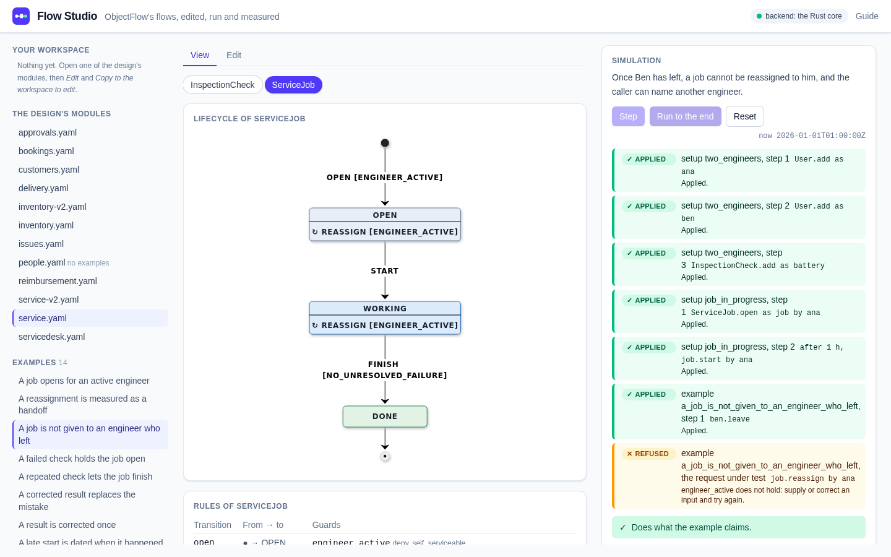
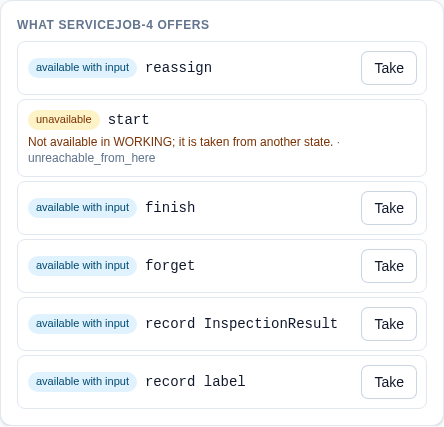
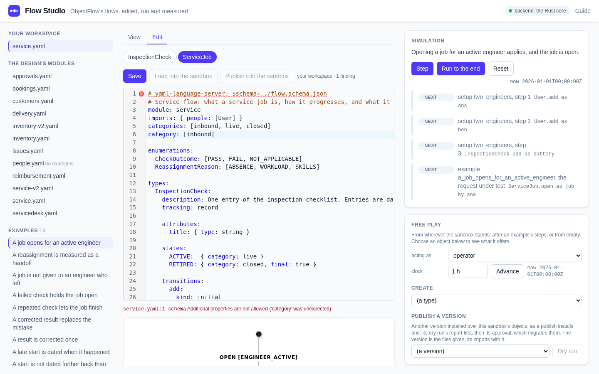
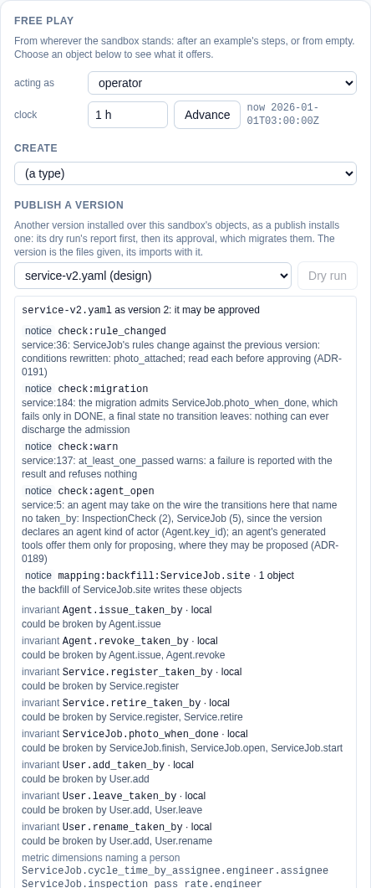
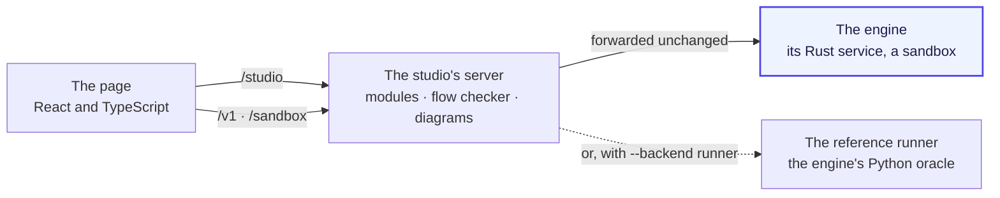

# Flow Studio

**Edit, run and measure ObjectFlow flows in the browser.**

The Flow Studio is the example application built on the engine. Open a flow, step through its examples against a live sandbox, see what every object may do next and why, edit the flow with the checker reading over your shoulder, and dry-run a new version over the objects you made. It reaches the engine only through the engine's own HTTP operations, so it is also a working sample of building on ObjectFlow.



## What you can do

### Run an example, step by step

Every flow ships with examples: short scenarios that set objects up, make a request and say what should happen. Choose one and *Step* through it, or *Run to the end*. Each step shows whether the engine applied or refused it and why, and the example ends saying whether the flow does what it claims. Above, a job cannot be reassigned to an engineer who has left: the request is refused by the rule `engineer_active`, with what to do about it, and the example holds.

### See what an object offers

Choose any object and the engine says, for each of its transitions, whether it is available now, available once you give it inputs, or not available and why. *Take* runs it, as whoever *acting as* names; *Propose* files it for someone else to approve where the flow allows. Free play goes on from wherever the sandbox stands, with the clock in your hands.

<p align="center"></p>

### Edit a flow, checked as you type

Copy a design module into your workspace and edit it as YAML. The flow checker reads it as you type and marks every finding against its line; a flow it finds wrong cannot be loaded. *Load into the sandbox* starts free play on your version, and a session you played can be saved as a new example, written only once the checker runs it and finds it holds.



### Publish a new version, dry run first

Choose a version under *Publish a version* and *Dry run*: the engine reports what the change would do to the objects you have, every notice the checker raises, each invariant the version could break and which transitions could break it, before anything changes. *Publish* then installs it and migrates the objects, each with its migration in its history.

<p align="center"></p>

## Quick start

You need Python 3.10 or later, Node with corepack, and [rustup](https://rustup.rs), which installs the Rust toolchain the engine pins on the first build. From the repository's root, once:

```sh
python3 -m venv apps/flow-studio/server/.venv
apps/flow-studio/server/.venv/bin/pip install -r apps/flow-studio/server/requirements-dev.txt
(cd apps/flow-studio/web && corepack pnpm install)
```

Then start it:

```sh
apps/flow-studio/scripts/dev
```

The first start builds the engine, which takes a few minutes. The script prints the page's address, `http://127.0.0.1:5711`; Ctrl-C stops everything it started. The page opens on the first module with examples; choose `service.yaml` to follow the tour above.

## How it fits together



The page asks the studio's server for modules, the checker's findings and diagrams, and sends every engine operation, `POST /v1/<operation>` and a sandbox's `POST /sandbox/<control>`, through it to the engine unchanged. The header says which engine answers: the Rust core by default, or the Python reference runner the core is held to. Both answer the same operations, so the studio runs on either.

## The flows it opens

The design's modules, in [`docs/design/flow-format/examples/`](../../docs/design/flow-format/examples/), each with its examples:

| Module | What it shows |
|---|---|
| `service.yaml` | a service job from opening to done: inspections, reassignment between engineers, handoffs measured |
| `service-v2.yaml` | the same flow's next version, to dry-run and publish over `service.yaml`'s objects |
| `approvals.yaml` | one approval lifecycle shared by purchase requests and expense claims |
| `delivery.yaml` | handing a reserved item over to its customer, a checklist and proposals on the way |
| `reimbursement.yaml` | staff expense claims and their lines: filed, reviewed, approved, recorded and paid, or returned, rejected or withdrawn |
| `bookings.yaml` | test rigs booked for spans of time, no two bookings of a rig overlapping |
| `customers.yaml` | personal data corrected and erased, and a customer that cannot close while an order is open |
| `inventory.yaml`, `inventory-v2.yaml` | a robot held in stock, and a version that tightens its rules |
| `issues.yaml` | Jira's work items, written in ObjectFlow's format |
| `servicedesk.yaml` | Jira Service Management's IT service flows: requests, incidents, problems, changes |
| `people.yaml` | the actors every flow above imports: people, agents and services |

The studio never edits these: it copies a module to your workspace, [`flows/`](flows/), to be edited there.

## Development

**The backends.** `backend` in [`config.json`](config.json) names the one the server starts with, `core` or `runner`, and `apps/flow-studio/scripts/dev runner` overrides it. With `core`, the server builds the engine's service with the toolchain `core/rust-toolchain.toml` pins, starts it as its child on a free loopback port, and forwards every `/v1` and `/sandbox` call to it unchanged, but for a load, which the flow checker checks first as it does for the runner.

**Ports.** Both are set in [`config.json`](config.json), and neither is a default: the server's, and the page's, which the server allows as the one origin that may call it.

**The server** is Python's standard library over the repository's reference runner and flow checker, in its own virtual environment holding the versions the scripts pin (`scripts/requirements-dev.txt`).

```sh
cd apps/flow-studio/server
.venv/bin/python -m flowstudio          # the server alone, on config.json's port
.venv/bin/python -m pytest              # the wire's tests, and every example replayed through it
```

The replay test plays every example of the design's modules through the wire, as a caller would, and holds each to the outcome the flow checker gives it, against the runner and against the core. A second test plays them through both backends at once and compares every answer whole; `tests/backend_differences.txt` lists where they are known to differ and why.

**The page** is TypeScript and React, built by Vite and styled with Tailwind; pnpm at the version `package.json` pins, through Node's corepack.

```sh
cd apps/flow-studio/web
corepack pnpm check                     # typecheck, lint, format and tests
```

Its tests play every example, a free session and a session saved as an example through the real server, once with each backend.

**A module's examples on the core**, the counterpart of the flow checker's step 6, which runs them on the reference runner:

```sh
apps/flow-studio/scripts/examples-on-core people.yaml service.yaml service.examples.yaml
```

It builds the core's service, starts it on a free port, plays every example of the examples file given last, the modules before it in import order, and prints each that does not pass with why; it exits 1 if any fails.

**By hand.** [`TESTING.md`](TESTING.md) has seven walks through the studio, each saying what every step should show.

**Its design** is [`docs/design/flow-studio.md`](../../docs/design/flow-studio.md); its decisions are ADR-0149 and ADR-0150.
